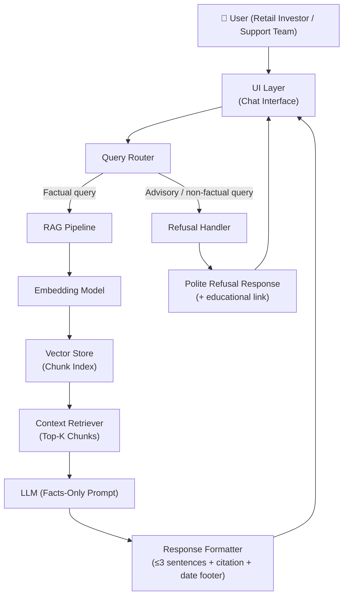
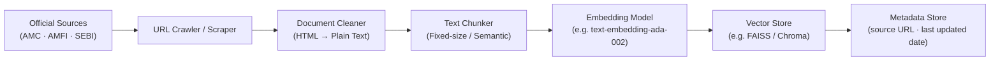
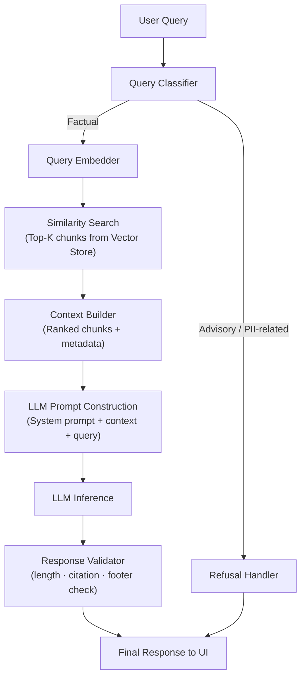
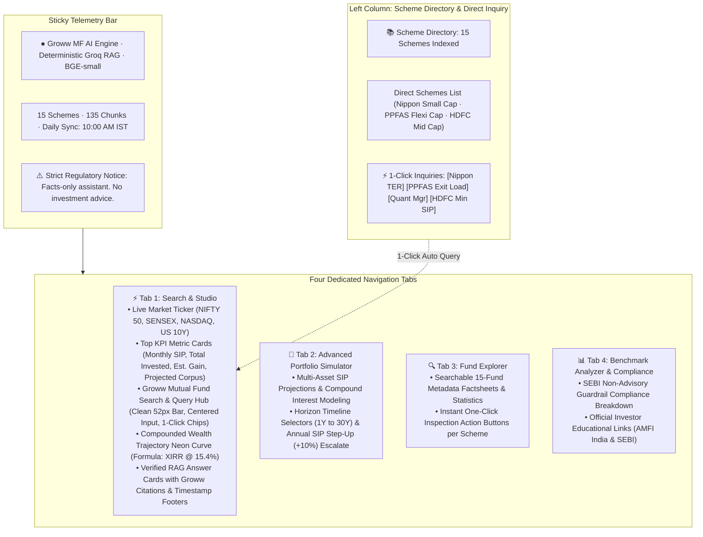
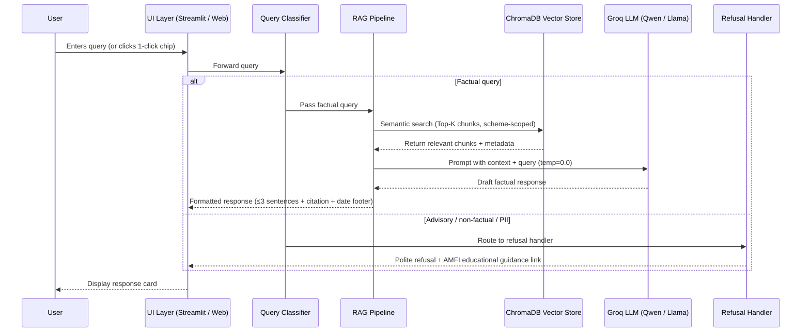
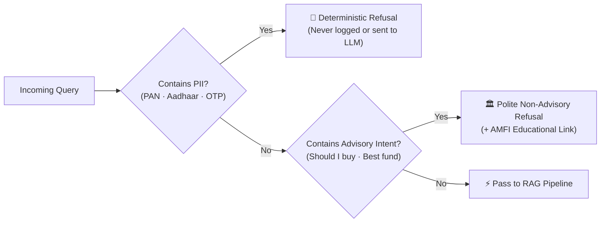

# Architecture: Mutual Fund FAQ Assistant (Facts-Only RAG System)

> [!NOTE]
> This document describes the end-to-end system architecture for the Mutual Fund FAQ Assistant — a lightweight, RAG-based, facts-only Q&A system built in the context of **Groww**.

---

## High-Level Architecture



---

## System Components

### 1. Data Ingestion Pipeline (Offline)

Responsible for building and maintaining the document corpus from official sources.



| Step | Description |
|---|---|
| **URL Crawler** | Fetches 15–25 curated official URLs (factsheets, KIM, SID, FAQ pages) |
| **Document Cleaner** | Strips HTML/PDF artifacts, normalizes whitespace |
| **Text Chunker** | Section-Aware Hybrid Chunker (atomic factual sections + fallback token splits) |
| **Embedding Model** | `BAAI/bge-small-en-v1.5` via fastembed ONNX (384-dim, free, local) |
| **Vector Store** | ChromaDB (local persistent, native metadata filtering & upsert) |
| **Metadata Store** | Preserves `scheme`, `amc`, `category`, `section`, `source_url`, `last_updated` |

---

### 2. Query Processing Pipeline (Online / Real-time)

Handles each incoming user query end-to-end.



---

### 3. Component Details

#### 3.1 Query Classifier

Determines whether a query is **factual** (allowed) or **advisory/non-factual** (refused).

| Query Type | Example | Action |
|---|---|---|
| Factual — scheme details | "What is the expense ratio of SBI Bluechip Fund?" | → RAG Pipeline |
| Factual — process | "How do I download my capital gains statement?" | → RAG Pipeline |
| Advisory | "Should I invest in this fund?" | → Refusal Handler |
| Comparative | "Which fund is better?" | → Refusal Handler |
| PII-related | Queries involving PAN / Aadhaar | → Refusal Handler |

> [!IMPORTANT]
> The classifier acts as the **first line of compliance**. It prevents any advisory, comparative, or PII-sensitive queries from reaching the LLM retrieval stage.

#### 3.2 RAG Pipeline

| Sub-component | Technology Options | Purpose |
|---|---|---|
| Embedding Model | `text-embedding-ada-002`, `sentence-transformers` | Encode query & chunks |
| Vector Store | `FAISS`, `ChromaDB`, `Weaviate` | Semantic chunk retrieval |
| LLM | `GPT-4o-mini`, `Gemini Flash`, `Claude Haiku` | Generate factual answer |
| Prompt Template | System-level facts-only instruction | Constrain LLM output |

**System Prompt Design:**
```
You are a facts-only mutual fund FAQ assistant.
- Answer ONLY using the provided context chunks.
- Limit your response to 3 sentences maximum.
- Include exactly one source citation link.
- Do NOT provide investment advice, opinions, or comparisons.
- If the answer is not in the context, say: "I could not find this information in the official documents."
```

#### 3.3 Response Formatter

Enforces the output contract on every LLM response:

```
[Answer — max 3 sentences]

Source: <citation URL>
Last updated from sources: <date>
```

> [!WARNING]
> Responses that fail validation (missing citation, exceed 3 sentences) must be regenerated or truncated before being returned to the user.

#### 3.4 Refusal Handler

Returns a templated, polite refusal for any non-factual query:

```
I'm only able to answer factual questions about mutual fund schemes
(e.g., expense ratios, exit loads, SIP minimums).
For guidance on investing, please visit: https://www.amfiindia.com/investor-corner

Facts-only. No investment advice.
```

---

### 4. User Interface Layer

A presentation-grade, compliance-first interface styled with **Groww's modern design system** (`#00D09C` emerald accents, `#080B10` obsidian dark surfaces, elevated slate cards, and Plus Jakarta Sans typography):



| Element | Description |
|---|---|
| **Live Market Ticker Bar** | Real-time global market indices: NIFTY 50, SENSEX, NASDAQ, and US 10Y with live feed status |
| **Top KPI Metric Cards** | 4-card overview grid: Monthly SIP, Total Invested, Est. Wealth Gain, and Projected Corpus |
| **Groww Search & Query Hub** | Super-sized 52px input dock, vertically centered placeholder, single emerald border, and 1-click factual chips |
| **Scheme Directory** | 15 curated direct growth schemes with verified expense ratios, exit loads, and fund managers |
| **Compounded Wealth Trajectory** | Interactive glowing SVG compounding curve with 3Y to 20Y horizon presets |
| **Portfolio Simulator Tab** | Dedicated wealth simulator modeling SIP step-ups, capital accumulation, and target CAGR adjustments |
| **Fund Explorer Tab** | Searchable multi-column catalog of all 15 indexed funds with verified stats and query triggers |
| **Benchmark Analyzer Tab** | Regulatory compliance sign-off, non-advisory verification rules, and investor education resources |

---

## Data Flow Summary



---

## Corpus Sources

| Source Type | Details | Format |
|---|---|---|
| Groww Scheme Factsheets | 15 curated scheme pages across 11 AMCs | HTML / Clean Text |
| KIM & SID Disclosures | Key Information Memorandums and Scheme Information Documents | HTML / PDF |
| AMC FAQ Pages | Official fee, tax, and exit load guidelines | HTML |
| AMFI Resources | Investor education portal (`amfiindia.com/investor-corner`) | HTML Link |
| SEBI Guidelines | SEBI (Investment Advisers) Regulations, 2013 | Policy Reference |

> [!NOTE]
> **15 curated Groww scheme URLs** across 11 AMCs (SBI, HDFC, Axis, Bandhan, Bank of India, Motilal Oswal, Kotak, Parag Parikh, Nippon India, ICICI Prudential, JioBlackRock) representing Small Cap, Mid Cap, Large Cap, Flexi Cap, Index, and Debt categories.

---

## Security & Privacy Constraints



> [!CAUTION]
> The system strictly enforces:
> - Zero collection or retention of PAN, Aadhaar numbers, OTPs, or bank account details.
> - Deterministic rejection of investment recommendations, return projections, or forward-looking promises.
> - Rate limiting via SlowAPI (60 requests/minute per IP) on all REST endpoints.

---

## Technology Stack (Production)

| Layer | Production Technology | Rationale |
|---|---|---|
| **Frontend / Dashboard** | **Streamlit 1.40+** (Groww Design System) | Multi-tab presentation UI with scheme navigator, factsheets, scheduler telemetry, and prompt chips |
| **Standalone Web Client** | **HTML5 / CSS3 / Vanilla JS** (`src/ui/index.html`) | Ultra-lightweight zero-overhead single page application served by FastAPI |
| **Backend / API** | **FastAPI** + **SlowAPI** + **Uvicorn** | Async REST API (`/query`, `/health`, `/schemes`, `/scheduler/*`) with rate limiting and schema validation |
| **LLM Inference** | **Groq Cloud** (`qwen/qwen3.8-27b`) | Sub-500ms deterministic inference (temp=0.0) with automatic multi-model fallback (`llama-3.1-8b`, `llama-3.3-70b`) |
| **Embeddings** | **BAAI/bge-small-en-v1.5** via `fastembed` | 100% free, runs locally on CPU via ONNX runtime, 384 dimensions, MTEB leader |
| **Vector Database** | **ChromaDB 0.5.18** (Local Persistent) | 135 atomic chunks with metadata filtering and HNSWlib bounds safety |
| **Scheduler Engine** | **APScheduler** + **GitHub Actions** | Automated daily synchronization at 10:00 AM IST (`0 10 * * *` Asia/Kolkata) |
| **Hosting & Deploy** | **Streamlit Community Cloud** (Live) + **Render** + **Docker** | Multi-target deployment with 24/7 keep-alive automation |

---

## Known Limitations

| Limitation | Impact | Mitigation |
|---|---|---|
| Static corpus | Data may become stale | Schedule periodic re-ingestion |
| No real-time NAV | Cannot answer live price queries | Direct users to official AMC site |
| PDF parsing accuracy | Tables/charts may be misread | Manual QA of critical chunks |
| LLM hallucination risk | May generate non-grounded answers | Strict system prompt + validator |
| Single AMC scope | Limited scheme coverage | Clearly stated in UI & README |

---

## Summary

The Mutual Fund FAQ Assistant follows a **two-stage architecture**:

1. **Offline** — a data ingestion pipeline that scrapes, cleans, chunks, embeds, and indexes official AMC/AMFI/SEBI documents into a vector store.
2. **Online** — a query pipeline that classifies each user query, retrieves relevant chunks via semantic search, and generates a short, cited, facts-only response using an LLM — or returns a polite refusal for non-factual queries.

The design prioritizes **compliance, transparency, and simplicity** over sophistication.

