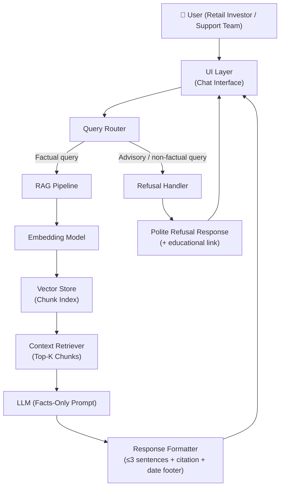
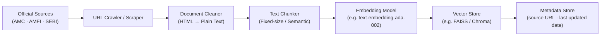
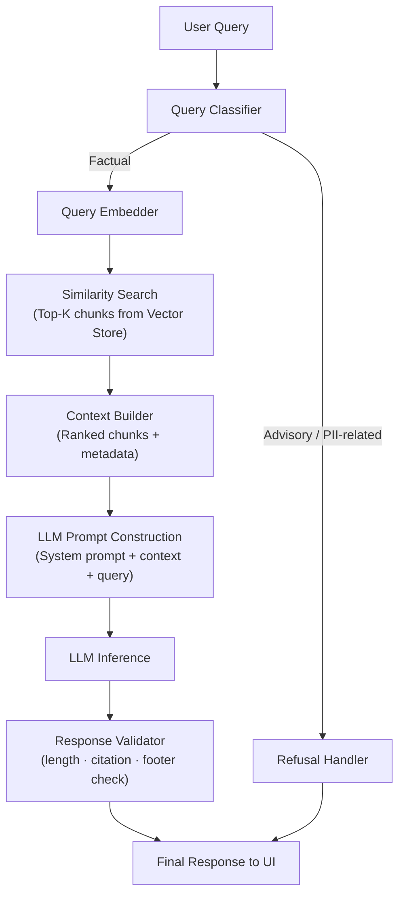
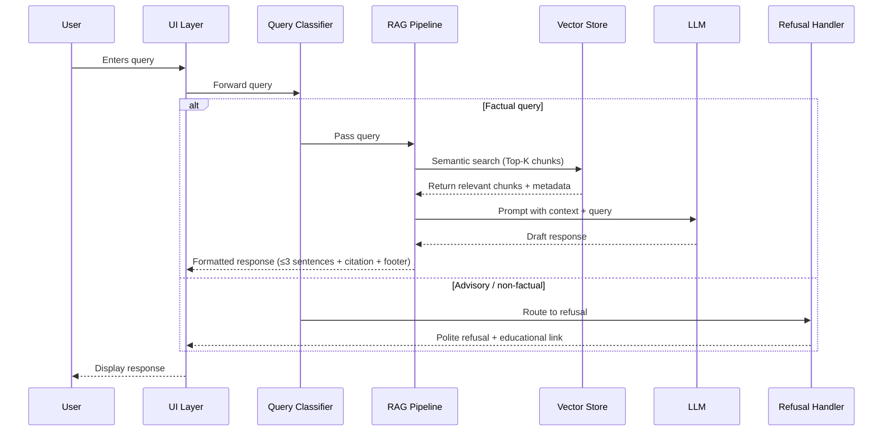
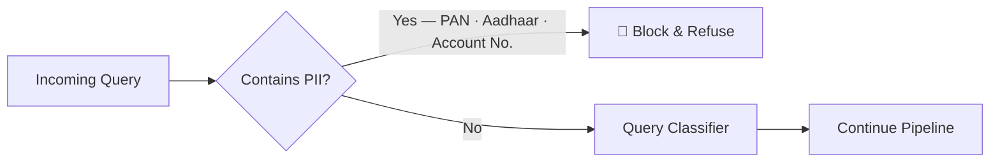

# Architecture: Mutual Fund FAQ Assistant (Facts-Only RAG System)

> [!NOTE]
> This document describes the end-to-end system architecture for the Mutual Fund FAQ Assistant — a lightweight, RAG-based, facts-only Q&A system built in the context of **Groww**.

---

## High-Level Architecture



---

## System Components

### 1. Data Ingestion Pipeline (Offline)

Responsible for building and maintaining the document corpus from official sources.



| Step | Description |
|---|---|
| **URL Crawler** | Fetches 15–25 curated official URLs (factsheets, KIM, SID, FAQ pages) |
| **Document Cleaner** | Strips HTML/PDF artifacts, normalizes whitespace |
| **Text Chunker** | Section-Aware Hybrid Chunker (atomic factual sections + fallback token splits) |
| **Embedding Model** | `BAAI/bge-small-en-v1.5` via fastembed ONNX (384-dim, free, local) |
| **Vector Store** | ChromaDB (local persistent, native metadata filtering & upsert) |
| **Metadata Store** | Preserves `scheme`, `amc`, `category`, `section`, `source_url`, `last_updated` |

---

### 2. Query Processing Pipeline (Online / Real-time)

Handles each incoming user query end-to-end.



---

### 3. Component Details

#### 3.1 Query Classifier

Determines whether a query is **factual** (allowed) or **advisory/non-factual** (refused).

| Query Type | Example | Action |
|---|---|---|
| Factual — scheme details | "What is the expense ratio of SBI Bluechip Fund?" | → RAG Pipeline |
| Factual — process | "How do I download my capital gains statement?" | → RAG Pipeline |
| Advisory | "Should I invest in this fund?" | → Refusal Handler |
| Comparative | "Which fund is better?" | → Refusal Handler |
| PII-related | Queries involving PAN / Aadhaar | → Refusal Handler |

> [!IMPORTANT]
> The classifier acts as the **first line of compliance**. It prevents any advisory, comparative, or PII-sensitive queries from reaching the LLM retrieval stage.

#### 3.2 RAG Pipeline

| Sub-component | Technology Options | Purpose |
|---|---|---|
| Embedding Model | `text-embedding-ada-002`, `sentence-transformers` | Encode query & chunks |
| Vector Store | `FAISS`, `ChromaDB`, `Weaviate` | Semantic chunk retrieval |
| LLM | `GPT-4o-mini`, `Gemini Flash`, `Claude Haiku` | Generate factual answer |
| Prompt Template | System-level facts-only instruction | Constrain LLM output |

**System Prompt Design:**
```
You are a facts-only mutual fund FAQ assistant.
- Answer ONLY using the provided context chunks.
- Limit your response to 3 sentences maximum.
- Include exactly one source citation link.
- Do NOT provide investment advice, opinions, or comparisons.
- If the answer is not in the context, say: "I could not find this information in the official documents."
```

#### 3.3 Response Formatter

Enforces the output contract on every LLM response:

```
[Answer — max 3 sentences]

Source: <citation URL>
Last updated from sources: <date>
```

> [!WARNING]
> Responses that fail validation (missing citation, exceed 3 sentences) must be regenerated or truncated before being returned to the user.

#### 3.4 Refusal Handler

Returns a templated, polite refusal for any non-factual query:

```
I'm only able to answer factual questions about mutual fund schemes
(e.g., expense ratios, exit loads, SIP minimums).
For guidance on investing, please visit: https://www.amfiindia.com/investor-corner

Facts-only. No investment advice.
```

---

### 4. User Interface Layer

A minimal, clean chat interface exposing only the essential elements:

| Element | Description |
|---|---|
| **Welcome Message** | Brief introduction to the assistant and its scope |
| **Example Questions** | 3 pre-filled clickable question prompts |
| **Chat Window** | User input + assistant response display |
| **Disclaimer Banner** | *"Facts-only. No investment advice."* — always visible |
| **Source Footer** | Appended to every assistant response |

---

## Data Flow Summary



---

## Corpus Sources

| Source Type | Examples | Format |
|---|---|---|
| AMC Factsheets | Monthly scheme factsheets | PDF / HTML |
| KIM | Key Information Memorandum | PDF |
| SID | Scheme Information Document | PDF |
| AMC FAQ Pages | Help & support pages | HTML |
| AMFI Resources | Investor education pages | HTML |
| SEBI Guidelines | Regulatory circulars | PDF / HTML |

> [!NOTE]
> **15–25 URLs** will be curated from a single AMC (e.g., SBI MF, Mirae Asset, HDFC MF) plus AMFI and SEBI public pages. No third-party or aggregator sources are permitted.

---

## Security & Privacy Constraints



> [!CAUTION]
> The system must **never** collect, store, log, or process:
> - PAN or Aadhaar numbers
> - Bank / demat account numbers
> - OTPs
> - Email addresses or phone numbers

---

## Technology Stack (Recommended)

| Layer | Technology |
|---|---|
| **Frontend / UI** | Streamlit / Next.js (minimal chat UI) |
| **Backend / API** | FastAPI / Python |
| **Embedding** | `BAAI/bge-small-en-v1.5` (Free/Local ONNX) or `text-embedding-3-small` |
| **Vector Store** | ChromaDB (local persistent, native metadata filtering & upsert) |
| **LLM** | GPT-4o-mini / Gemini Flash / Claude Haiku |
| **PDF Parsing** | `PyMuPDF` / `pdfplumber` |
| **Web Scraping** | `requests` + `BeautifulSoup` / `scrapy` |
| **Metadata Store** | SQLite / JSON flat file |

---

## Known Limitations

| Limitation | Impact | Mitigation |
|---|---|---|
| Static corpus | Data may become stale | Schedule periodic re-ingestion |
| No real-time NAV | Cannot answer live price queries | Direct users to official AMC site |
| PDF parsing accuracy | Tables/charts may be misread | Manual QA of critical chunks |
| LLM hallucination risk | May generate non-grounded answers | Strict system prompt + validator |
| Single AMC scope | Limited scheme coverage | Clearly stated in UI & README |

---

## Summary

The Mutual Fund FAQ Assistant follows a **two-stage architecture**:

1. **Offline** — a data ingestion pipeline that scrapes, cleans, chunks, embeds, and indexes official AMC/AMFI/SEBI documents into a vector store.
2. **Online** — a query pipeline that classifies each user query, retrieves relevant chunks via semantic search, and generates a short, cited, facts-only response using an LLM — or returns a polite refusal for non-factual queries.

The design prioritizes **compliance, transparency, and simplicity** over sophistication.

