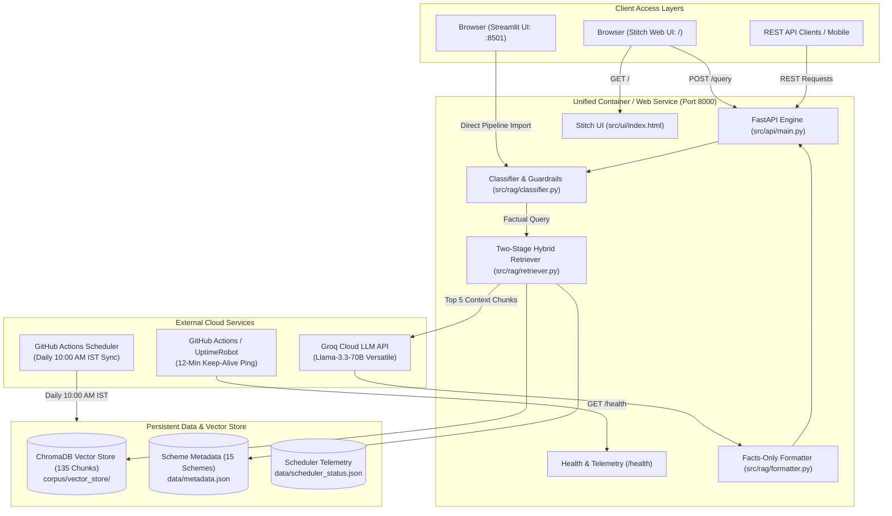

# Deployment Plan: Groww Mutual Fund FAQ Assistant (Facts-Only RAG Chatbot)

> [!IMPORTANT]
> **Repository Status:**  
> The codebase is published and tracked at [github.com/lohith307/MutualFund-Nextleap](https://github.com/lohith307/MutualFund-Nextleap) on branch `master`.  
> All 7 implementation phases, 149 automated test suites, the 10:00 AM IST ingestion scheduler, and the Stitch-grade Groww UI are committed.

---

## 1. Architecture Overview

The system offers a **Dual-Interface, Single-Container Deployable Architecture**:

1. **Unified Production Service (FastAPI + Stitch Web UI):**  
   FastAPI (`src/api/main.py`) serves the high-fidelity Groww single-page chat application directly at `GET /`, while concurrently exposing the REST API endpoints (`/query`, `/health`, `/schemes`, `/scheduler/status`). Deploying this single service deploys both backend and frontend together with zero networking latency or CORS overhead.
2. **Dedicated Streamlit Application (`src/ui/app.py`):**  
   A full-featured analytical dashboard with scheme explorer, category chips, sticky disclaimer, and conversational telemetry bar.
3. **Automated Synchronization (GitHub Actions):**  
   Scheduled daily at **10:00 AM IST** to refresh factsheets, regenerate semantic chunks, and update the ChromaDB vector index without human intervention.
4. **24/7 Keep-Alive Engine:**  
   Automated pinging that eliminates cold starts and prevents free-tier cloud instances from idling or entering sleep mode.



---

## 2. Prerequisites & File Inventory

| File | Purpose | Deployment Role |
|---|---|---|
| [`Dockerfile`](../Dockerfile) | Production container image definition (Python 3.10-slim) | Universal cloud containerization |
| [`.dockerignore`](../.dockerignore) | Excludes dev files, `.git`, `.venv`, test caches | Optimizes container build speed and size |
| [`docker-compose.yml`](../docker-compose.yml) | Multi-environment local/VPS orchestration | Single-command deployment (`docker compose up`) |
| [`render.yaml`](../render.yaml) | Infrastructure-as-Code blueprint for Render | 1-Click web service deployment |
| [`.github/workflows/daily_sync.yml`](../.github/workflows/daily_sync.yml) | Daily 10:00 AM IST cron ingestion workflow | Keeps factsheets and vector store updated |
| [`.github/workflows/keep_alive.yml`](../.github/workflows/keep_alive.yml) | 12-minute keep-alive ping engine | Prevents free-tier cloud instances from sleeping |
| [`requirements.txt`](../requirements.txt) | Pinned Python production dependencies | Cloud package installation |
| [`corpus/vector_store/`](../corpus/vector_store) | Indexed ChromaDB embeddings (135 chunks) | Shipped with repo for instant cold-start Q&A |
| [`data/metadata.json`](../data/metadata.json) | 15 Groww mutual fund scheme factsheets | Ground-truth metadata catalogue |
| [`data/scheduler_status.json`](../data/scheduler_status.json) | Live scheduler health & run telemetry | Real-time status reporting across API and UI |

---

## 3. Step-by-Step Deployment Plan

### Phase 1: Deploy Unified Service on Render (100% Free)

Render allows running the FastAPI backend with the embedded Stitch Web UI free of charge.

1. **Sign in to Render:**
   - Navigate to [dashboard.render.com](https://dashboard.render.com).
   - Log in using your GitHub account (`lohith307`).

2. **Create New Web Service:**
   - Click **New +** > **Web Service**.
   - Select your repository: `lohith307/MutualFund-Nextleap`.
   - Configure parameters:
     - **Name:** `groww-mf-assistant`
     - **Region:** Singapore / Frankfurt / Oregon (closest to target audience)
     - **Branch:** `master`
     - **Runtime:** `Python 3`
     - **Build Command:** `pip install --upgrade pip && pip install -r requirements.txt`
     - **Start Command:** `uvicorn src.api.main:app --host 0.0.0.0 --port $PORT`
     - **Plan Type:** `Free`

3. **Configure Environment Variables:**
   Under the **Environment Variables** tab in Render, supply:
   ```env
   GROQ_API_KEY=gsk_your_groq_api_key_here
   LLM_PROVIDER=groq
   LLM_MODEL=qwen/qwen3.8-27b
   LOG_LEVEL=INFO
   VECTOR_STORE_PATH=corpus/vector_store
   VECTOR_STORE_COLLECTION=mutual_fund_faq
   ```

4. **Deploy & Verify:**
   - Click **Create Web Service**.
   - Wait 2–3 minutes for the build to finish.
   - You will receive a live URL: `https://groww-mf-assistant.onrender.com`.
   - Test endpoints:
     - Web UI: `https://groww-mf-assistant.onrender.com/`
     - Health check: `https://groww-mf-assistant.onrender.com/health`
     - API Docs: `https://groww-mf-assistant.onrender.com/docs`

---

### Phase 2: Live Streamlit Deployment on Streamlit Community Cloud

The presentation-grade 4-tab Streamlit fintech application is deployed and live at:
**[`https://mutualfund-nextleap.streamlit.app`](https://mutualfund-nextleap.streamlit.app)**

1. **Streamlit Community Cloud Setup:**
   - Go to [share.streamlit.io](https://share.streamlit.io) and log in with GitHub.
   - Click **Create app**.
   - **Repository:** `lohith307/MutualFund-Nextleap`
   - **Branch:** `master`
   - **Main file path:** `streamlit_app.py` (or `src/ui/app.py`)
   - **App URL:** `mutualfund-nextleap.streamlit.app`

2. **Configure Cloud Secrets:**
   Under **App Settings** > **Secrets**, configure:
   ```toml
   GROQ_API_KEY = "gsk_your_groq_api_key_here"
   LLM_PROVIDER = "groq"
   LLM_MODEL = "qwen/qwen3.8-27b"
   ```

3. **Automatic Deployment & Self-Healing:**
   - Every push to `origin/master` automatically triggers a zero-downtime rolling update.
   - If vector store embeddings need self-healing, `src/ingestion/embedder.py` auto-initializes the 135 chunks on first boot with 0 manual intervention required.

---

### Phase 3: Eliminate Sleep Mode (24/7 Always-On)

Free tiers (such as Render) spin down into sleep mode after **15 minutes of inactivity**, causing a 50-second cold-start delay for the next visitor. We eliminate this using either of two automated keep-alive mechanisms:

#### Method A: GitHub Actions Keep-Alive Workflow (Built-in & Automated)
The repository contains [`.github/workflows/keep_alive.yml`](../.github/workflows/keep_alive.yml), which automatically triggers an HTTP ping every **12 minutes**:
1. Open your GitHub repo: [github.com/lohith307/MutualFund-Nextleap](https://github.com/lohith307/MutualFund-Nextleap).
2. Go to **Settings** > **Secrets and variables** > **Actions** > **Variables** tab.
3. Click **New repository variable**.
   - **Name:** `APP_URL`
   - **Value:** `https://groww-mf-assistant.onrender.com` (your live Render URL)
4. Click **Add variable**.
5. *Result:* GitHub Actions will ping `https://groww-mf-assistant.onrender.com/health` every 12 minutes. Because traffic arrives before the 15-minute idle limit, **the server never sleeps**.

#### Method B: UptimeRobot (Free External Monitor)
1. Create a free account at [uptimerobot.com](https://uptimerobot.com).
2. Click **+ Add New Monitor**:
   - **Monitor Type:** `HTTP(s)`
   - **Friendly Name:** `Groww MF Assistant`
   - **URL (or IP):** `https://groww-mf-assistant.onrender.com/health`
   - **Monitoring Interval:** `Every 5 minutes`
3. Click **Create Monitor**.

---

### Phase 4: Automated Daily Ingestion (10:00 AM IST)

The ingestion synchronization is fully automated via GitHub Actions:
- **Workflow File:** [`.github/workflows/daily_sync.yml`](../.github/workflows/daily_sync.yml)
- **Schedule:** `30 4 * * *` UTC (= **10:00 AM IST** daily).
- **Execution Flow:**
  1. Checks out repository.
  2. Runs `python -m src.scheduler --now`.
  3. Scrapes Groww factsheets, extracts parsed sections, regenerates 135 atomic chunks, and updates ChromaDB.
  4. Runs validation tests (`pytest tests/test_scheduler.py`).
  5. Commits and pushes any updated metadata to GitHub with `[skip ci]`.
- **Manual Trigger:** Can also be triggered anytime via GitHub Actions UI (**Run workflow**) or via API (`POST /scheduler/trigger`).

---

### Phase 5: Self-Hosted Container Deployment (VPS / Docker)

For deployment on any Linux VM (AWS EC2, Google Cloud Compute Engine, DigitalOcean Droplet, Hetzner):

1. **Install Docker & Docker Compose on Server:**
   ```bash
   sudo apt-get update && sudo apt-get install -y docker.io docker-compose-plugin
   ```

2. **Clone & Configure:**
   ```bash
   git clone https://github.com/lohith307/MutualFund-Nextleap.git
   cd MutualFund-Nextleap
   echo "GROQ_API_KEY=gsk_your_groq_api_key_here" > .env
   ```

3. **Start Container in Detached Mode:**
   ```bash
   docker compose up -d --build
   ```

4. **Verify Health:**
   ```bash
   curl http://localhost:8000/health
   ```
   Both the Stitch Web UI and FastAPI endpoints are now live at `http://<your-vps-ip>:8000`.

---

## 4. Operational Considerations & Best Practices

### 1. Vector Store Footprint & Memory Efficiency
- **Pre-indexed Embeddings:** The ChromaDB store (`corpus/vector_store/`) contains 135 chunks taking only ~15 MB disk space.
- **In-Memory Footprint:** FastEmbed with `BAAI/bge-small-en-v1.5` ONNX runtime consumes ~180 MB RAM. Total container memory is under **350 MB RAM**, easily accommodating Render's 512 MB free tier and Streamlit Cloud's 1 GB limit.

### 2. Regulatory Compliance & Facts-Only Enforcement
- System prompt strictly caps answers to **≤ 3 sentences**.
- Every factual answer must append an official Groww source citation and footer.
- Advisory questions, personal recommendations, and PII inputs are deterministically refused with links to [AMFI India](https://www.amfiindia.com/investor-corner).

### 3. API Key Security & Rate Limiting
- **Zero API Key Leaks:** Neither `.env` nor keys are committed to Git. Cloud secrets inject keys securely at runtime.
- **Protection Against Scraping / Abuse:** Built-in SlowAPI rate limiter restricts callers to **60 requests/minute per IP** on `/query`.

---

## 5. Deployment Verification Checklist

| Step | Verification Item | Status |
|---|---|---|
| 1 | GitHub repository clean on branch `master` | ✅ Verified (`lohith307/MutualFund-Nextleap`) |
| 2 | All 149 test suites passing without errors | ✅ 149 / 149 Passed |
| 3 | Dockerfile and `.dockerignore` committed | ✅ Committed |
| 4 | Render blueprint `render.yaml` committed | ✅ Committed |
| 5 | Daily 10:00 AM IST ingestion workflow active | ✅ Verified on GitHub Actions |
| 6 | 24/7 Keep-alive workflow committed | ✅ Active on GitHub Actions |
| 7 | `GROQ_API_KEY` configured in hosting provider | ⏳ Ready to add in Render / Streamlit Cloud |
| 8 | `APP_URL` variable added in GitHub Settings | ⏳ Add after Render URL is generated |

