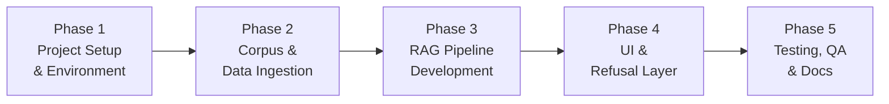
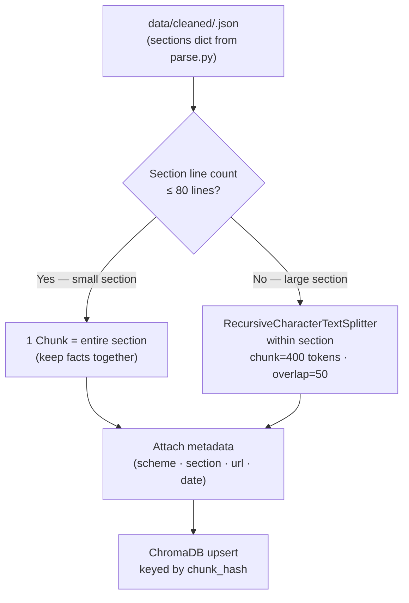
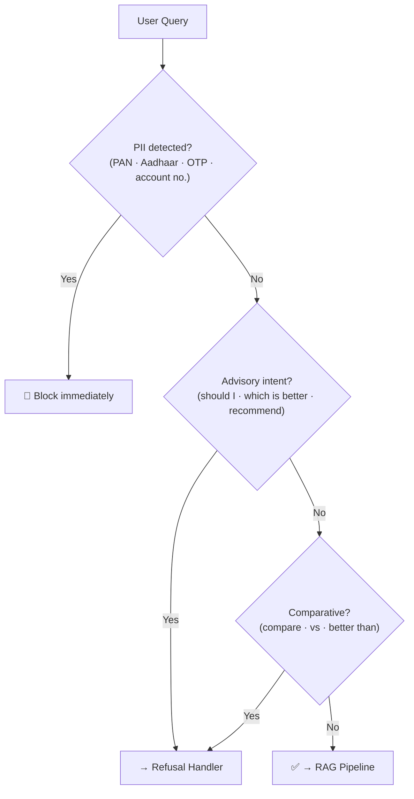
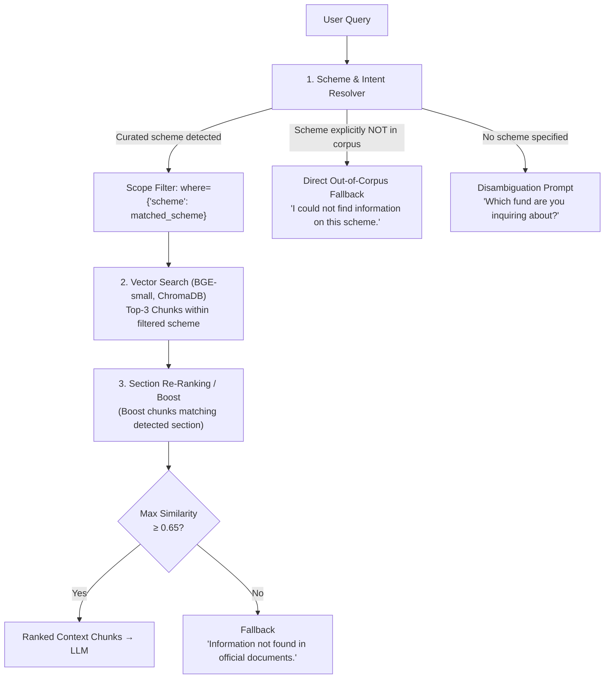
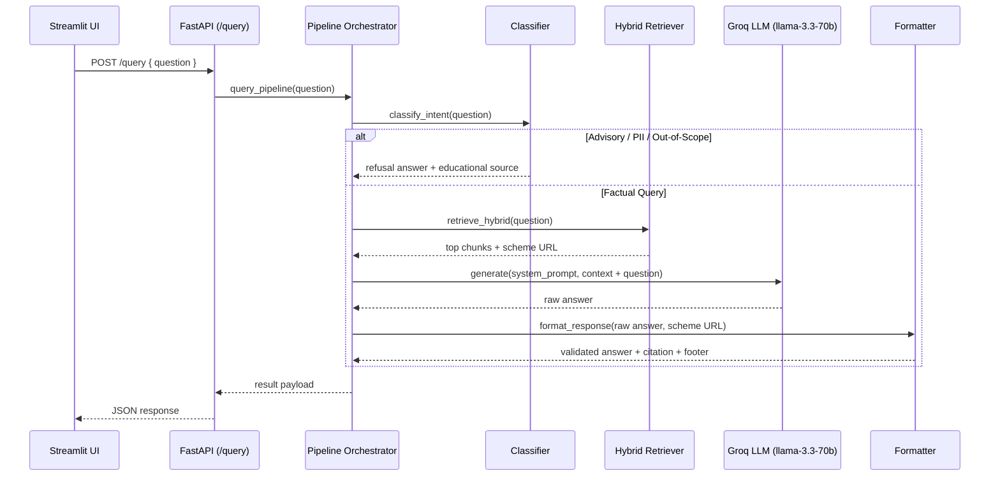

# Implementation Plan: Mutual Fund FAQ Assistant

> [!NOTE]
> This plan translates the [Problem Statement](./problemstatement.md) and [Architecture](./architecture.md) into concrete, phased development tasks with clear deliverables, owners, and acceptance criteria.

---

## Project Overview

| Attribute | Detail |
|---|---|
| **Product** | Facts-Only Mutual Fund FAQ Assistant |
| **Reference Context** | Groww |
| **Approach** | RAG (Retrieval-Augmented Generation) |
| **Total Phases** | 5 |
| **Estimated Duration** | ~3–4 weeks |

---

## Phased Roadmap



---

## Phase 1 — Project Setup & Environment

**Goal:** Establish the project structure, tooling, and dependencies before any feature work begins.

### Tasks

| # | Task | Details |
|---|---|---|
| 1.1 | **Initialize repository** | Create project repo with `.gitignore`, `README.md` stub, `LICENSE` |
| 1.2 | **Set up virtual environment** | Python 3.10+, `venv` or `conda` |
| 1.3 | **Install core dependencies** | `langchain`, `chromadb` / `faiss-cpu`, `openai` / `google-generativeai`, `fastapi`, `streamlit`, `PyMuPDF`, `pdfplumber`, `requests`, `beautifulsoup4`, `python-dotenv` |
| 1.4 | **Configure environment variables** | `.env` file for API keys (OpenAI / Gemini), never committed to repo |
| 1.5 | **Define project folder structure** | See structure below |
| 1.6 | **Set up linting & formatting** | `ruff` / `black`, `pre-commit` hooks |

### Project Folder Structure

```
mutual-fund-faq/
├── data/
│   ├── raw/                  # Downloaded HTML/PDF source files
│   ├── cleaned/              # Plain-text cleaned documents
│   └── metadata.json         # URL → last-updated date mapping
├── corpus/
│   └── vector_store/         # ChromaDB / FAISS index files
├── src/
│   ├── ingestion/
│   │   ├── crawler.py        # URL fetcher & scraper
│   │   ├── cleaner.py        # HTML/PDF → plain text
│   │   ├── chunker.py        # Text splitting logic
│   │   └── embedder.py       # Embedding + vector store writer
│   ├── pipeline/
│   │   ├── classifier.py     # Query classifier (factual vs advisory)
│   │   ├── retriever.py      # Similarity search wrapper
│   │   ├── prompt.py         # Prompt templates
│   │   ├── llm.py            # LLM inference wrapper
│   │   └── formatter.py      # Response validator & formatter
│   ├── api/
│   │   └── main.py           # FastAPI app
│   └── ui/
│       └── app.py            # Streamlit chat interface
├── tests/
│   ├── test_classifier.py
│   ├── test_retriever.py
│   ├── test_formatter.py
│   └── test_refusal.py
├── docs/
│   ├── problemstatement.md
│   ├── architecture.md
│   └── implementationplan.md
├── .env.example
├── requirements.txt
└── README.md
```

### Acceptance Criteria
- [ ] Repo initialized with correct folder structure
- [ ] `pip install -r requirements.txt` runs without errors
- [ ] `.env.example` documents all required keys
- [ ] Linter passes on empty scaffold

---

## Phase 2 — Corpus Curation & Data Ingestion Pipeline

**Goal:** Build and index the official document corpus that the RAG system will retrieve from.

### 2.1 — Corpus URL Curation

Select **one AMC** and curate **15–25 official public URLs**:

| Source Category | Target Count | Example URLs |
|---|---|---|
| AMC Scheme Factsheets | 5–8 | `https://<amc>.com/factsheet/...` |
| KIM (Key Information Memorandum) | 3–4 | AMC investor downloads section |
| SID (Scheme Information Document) | 2–3 | AMC regulatory documents section |
| AMC FAQ / Help Pages | 2–3 | AMC support / help center |
| AMFI Investor Education Pages | 2–3 | `https://www.amfiindia.com/investor-corner` |
| SEBI Regulatory Pages | 1–2 | `https://www.sebi.gov.in/...` |

> [!IMPORTANT]
> Only official public sources are permitted. No third-party blogs, aggregators, or paywalled content.

Save all URLs to `data/metadata.json` with the following schema:
```json
{
  "sources": [
    {
      "url": "https://...",
      "type": "factsheet | KIM | SID | FAQ | AMFI | SEBI",
      "scheme": "SBI Bluechip Fund",
      "last_fetched": "2026-10-29"
    }
  ]
}
```

### 2.2 — Document Crawler (`src/ingestion/crawler.py`)

| Task | Details |
|---|---|
| Fetch HTML pages | `requests` + `BeautifulSoup`, respect `robots.txt` |
| Download PDFs | Stream binary to `data/raw/` |
| Rate limiting | Add `time.sleep(1–2s)` between requests |
| Error handling | Log failed URLs, skip and continue |

### 2.3 — Document Cleaner (`src/ingestion/cleaner.py`)

| Input | Processing | Output |
|---|---|---|
| Raw HTML | Strip tags, remove nav/footer boilerplate | Plain text |
| Raw PDF | `PyMuPDF` / `pdfplumber` extraction | Plain text |
| All | Normalize whitespace, remove empty lines | Cleaned `.txt` in `data/cleaned/` |

### 2.4 — Text Chunker (`src/ingestion/chunker.py`)

> [!IMPORTANT]
> Since `parse.py` already extracts and tags content into **9 named sections** per fund, we use a **Section-Aware Hybrid chunking strategy** rather than naive sliding-window chunking. This directly improves retrieval precision — a query about expense ratio fetches only `expense_ratio` chunks, not generic text.

#### Chunking Strategy: Section-Aware Hybrid



#### Why Section-Aware over Naive Sliding Window

| Approach | Problem | With Section-Aware |
|---|---|---|
| Naive 400-token window | Expense ratio + exit load mixed in same chunk → retrieval confusion | Each section is its own chunk boundary |
| No overlap | Answer splits across chunk boundary (e.g. "exit load is 1% if..." cut mid-sentence) | Overlap only applied *within* large sections |
| No section metadata | Retriever can't filter by topic | `section` tag on every chunk enables keyword pre-filtering |

#### Section → Chunk Size Guide

Based on typical Groww page content per section:

| Section | Typical Lines | Strategy |
|---|---|---|
| `expense_ratio` | 2–5 lines | **Single chunk** — always keep together |
| `exit_load` | 3–8 lines | **Single chunk** — full exit load terms must stay intact |
| `minimum_investment` | 2–4 lines | **Single chunk** |
| `benchmark` | 1–3 lines | **Single chunk** |
| `fund_management` | 5–15 lines | **Single chunk** (manager name + tenure + experience must stay together) |
| `tax` | 3–10 lines | **Single chunk** (STCG/LTCG/lock-in must stay together) |
| `investment_objective` | 3–8 lines | **Single chunk** |
| `fund_house` | 2–5 lines | **Single chunk** |
| `overview` | 10–30 lines | **Split if > 80 lines**, else single chunk |
| `_unclassified` | Variable | **Skip** — do not embed unclassified content |

#### Chunk Metadata Schema (per chunk)

```python
{
  "chunk_id":    "<slug>_<section>_<index>",   # unique, stable, upsert key
  "scheme":      "HDFC Mid Cap Fund",
  "amc":         "HDFC Mutual Fund",
  "category":    "Mid Cap",
  "section":     "expense_ratio",              # section tag for filtering
  "source_url":  "https://groww.in/...",
  "last_updated": "2026-10-29",
  "text":        "Expense Ratio: 1.45%..."
}
```

#### Parameters

| Parameter | Value | Rationale |
|---|---|---|
| **Primary strategy** | Section-per-chunk | Sections are already factually coherent units |
| **Max lines per chunk** | 80 lines before splitting | Prevents embedding window overflow |
| **Fallback chunk size** | 400 tokens | For large `overview` / `_unclassified` sections |
| **Fallback overlap** | 50 tokens | Preserves sentence continuity at split boundaries |
| **Fallback splitter** | `RecursiveCharacterTextSplitter` | Splits on `\n\n` → `\n` → `.` → ` ` in order |
| **Skip sections** | `_unclassified` | Unclassified lines are noisy and reduce retrieval precision |
| **Upsert key** | `chunk_id = <slug>_<section>_<index>` | Idempotent re-ingestion without duplicates |

### 2.5 — Embedder & Indexer (`src/ingestion/embedder.py`)

#### Vector Store Choice: ChromaDB (over FAISS)
ChromaDB is selected as the primary vector store for this system based on our dataset characteristics (~150 chunks across 15 schemes):
- **Native Metadata Filtering:** Direct support for `where={"section": "expense_ratio"}` or `where={"scheme": "..."}` to pinpoint factual categories without scanning extraneous data.
- **Native Upsert & Deduplication:** Idempotent re-indexing via stable `chunk_id` (`<slug>__<section>__<index>`), ensuring no duplicate vectors upon re-runs.
- **Embedded Local Persistence:** Automatically persists to disk (`corpus/vector_store/`) without needing external server infrastructure.
- **Text & Source Co-location:** Returns chunk text, citation URLs, and last updated dates directly in search query results.

#### Embedding Model Choice: BGE Model (BAAI/bge-small-en-v1.5)
- **Primary Model:** `BAAI/bge-small-en-v1.5` (Free, open-source, local execution via ONNX/FastEmbed or HuggingFace).
- **Chunk Compatibility:** 512-token context window fully accommodates all our chunks (30–400 tokens).
- **Resource Footprint:** ~133 MB size, 384-dimensional embeddings, <20ms CPU latency per query.
- **Configurability:** Supports swapping to `BAAI/bge-large-en-v1.5` (1024-dim) or OpenAI `text-embedding-3-small` via `.env` settings.
- **Asymmetric Instruction:** For retrieval, queries use the instruction prefix `Represent this sentence for searching relevant passages: `, while document chunks are indexed directly.

| Step | Implementation |
|---|---|
| Embed chunks | `BAAI/bge-small-en-v1.5` (default local) or `BAAI/bge-large-en-v1.5` / OpenAI fallback |
| Store vectors | ChromaDB (local persistent in `corpus/vector_store/`) |
| Store metadata | `chunk_id`, `scheme`, `amc`, `category`, `section`, `source_url`, `last_updated` |
| Re-ingestion | Upsert by `chunk_id` to ensure idempotency |

### Phase 2 Acceptance Criteria
- [x] `metadata.json` contains 15–25 verified official URLs
- [x] All documents downloaded to `data/raw/` via `src/ingestion/fetch.py`
- [x] All cleaned text and section files present in `data/cleaned/` via `src/ingestion/parse.py`
- [x] All chunks generated in `data/chunks/` via `src/ingestion/chunker.py`
- [x] Vector store populated and queryable via `src/ingestion/embedder.py`
- [x] Metadata (`source_url`, `last_updated`, `section`, `scheme`) retrievable per chunk

---

## Phase 3 — RAG Query Pipeline Development

**Goal:** Build the online query pipeline — classify, retrieve, generate, validate, and format responses.

### 3.1 — Query Classifier (`src/pipeline/classifier.py`)

Classify each incoming query before routing it:



**Implementation approach:**
- Rule-based keyword matching for PII and advisory intent (fast, deterministic)
- Optional: lightweight classifier using an LLM prompt for edge cases

**Keyword lists to maintain:**

| Category | Keywords / Patterns |
|---|---|
| PII | `PAN`, `Aadhaar`, `OTP`, `account number`, `bank`, `password` |
| Advisory | `should I`, `recommend`, `which is better`, `worth investing`, `good fund` |
| Comparative | `compare`, `vs`, `versus`, `better than`, `difference between` |

### 3.2 — Retriever (`src/pipeline/retriever.py`): Two-Stage Scheme-Aware Hybrid Retrieval

Based on our empirical analysis of the 135 corpus chunks in ChromaDB, queries combine an **Entity (Scheme)** and an **Attribute (Section)**. Pure semantic search risks cross-scheme contamination (e.g. Bandhan exit load query pulling HDFC exit load with high similarity). Therefore, the retriever uses a **Two-Stage Scheme-Aware Hybrid Retrieval** strategy:



| Step | Detail |
|---|---|
| **Stage 1: Scheme Resolution** | Matches query against the 15 corpus scheme names/aliases. If an out-of-corpus scheme is identified (e.g., Quant Small Cap), returns immediate honest fallback without querying ChromaDB. If no scheme is specified, prompts for clarification. |
| **Stage 2: Scoped Vector Search** | Embeds query via `BAAI/bge-small-en-v1.5` with query instruction prefix, queries ChromaDB with `where={"scheme": matched_scheme}` to isolate target fund. |
| **Stage 3: Section Boosting** | If query mentions specific keywords (`expense ratio`, `exit load`, `manager`, `sip`, `benchmark`, `tax`), boosts chunks tagged with that `section`. |
| **Stage 4: Score Thresholding** | Minimum similarity threshold set to `0.65`. Queries below threshold return the compliant fallback message: *"I could not find this information in the official documents."* |
| **Output** | List of retrieved chunk dicts containing `text`, `source_url`, `last_updated`, `scheme`, and `section`. |

### 3.3 — Prompt Builder (`src/pipeline/prompt.py`)

Constructs the final LLM prompt using retrieved context:

```python
SYSTEM_PROMPT = """
You are a facts-only mutual fund FAQ assistant.
- Answer ONLY using the provided context. Do not use prior knowledge.
- Limit your response to 3 sentences maximum.
- Include exactly one source citation link from the context.
- Do NOT provide investment advice, opinions, or comparisons.
- If the answer is not in the context, respond exactly:
  "I could not find this information in the official documents."
"""

USER_PROMPT_TEMPLATE = """
Context:
{context}

Question: {question}
"""
```

### 3.4 — LLM Inference (`src/pipeline/llm.py`)

| Setting | Value |
|---|---|
| Model | `gpt-4o-mini` / `gemini-1.5-flash` / `claude-3-haiku` |
| Temperature | `0.0` (deterministic, no creativity) |
| Max tokens | `200` (enforces brevity) |
| Retry logic | 3 retries with exponential backoff on API errors |

### 3.5 — Response Formatter & Validator (`src/pipeline/formatter.py`)

Every LLM response must be validated before returning to the user:

| Check | Rule | On Failure |
|---|---|---|
| Sentence count | ≤ 3 sentences | Truncate to 3 sentences |
| Citation present | Response contains a valid URL | Re-prompt LLM or append source URL from metadata |
| No advice language | Doesn't contain "recommend", "should", "suggest" | Regenerate or fallback to refusal |
| Footer | Append `Last updated from sources: <date>` | Always append from metadata |

**Output format:**
```
<Answer in ≤ 3 sentences.>

Source: <URL>
Last updated from sources: <YYYY-MM-DD>
```

### Phase 3 Acceptance Criteria
- [ ] Classifier correctly routes factual vs advisory queries (manual test set of 20 queries)
- [ ] Retriever returns relevant chunks with source metadata
- [ ] LLM returns grounded answers using only provided context
- [ ] All responses pass validation (length, citation, footer)
- [ ] Response time < 5 seconds end-to-end

---

## Phase 4 — Refusal Layer, Groq LLM & User Interface

**Goal:** Integrate Groq as the primary ultra-fast LLM provider, build the FastAPI service, and deliver the user-friendly Streamlit chat UI.

### 4.1 — Groq LLM Integration (`src/pipeline/llm.py`)

Groq is configured as the primary LLM provider for the RAG generation step:
- **Provider:** Groq Cloud API (`groq` Python SDK)
- **Primary Model:** `llama-3.3-70b-versatile` (high factual accuracy, strict constraint adherence)
- **Fallback / Lightweight Model:** `llama-3.1-8b-instant`
- **Inference Latency:** Sub-second (~300-600ms token generation), enabling near-instant user responses
- **Cost:** Free tier tier available for developer evaluation
- **Determinism:** `temperature=0.0`, `max_tokens=200` to enforce concise ≤ 3-sentence answers
- **Resilience:** Fallbacks and retries with exponential backoff via `tenacity` (handles rate limits & timeouts). Also supports Google Gemini (`gemini-1.5-flash`) and OpenAI (`gpt-4o-mini`) via environment switch.

### 4.2 — Refusal Handler (`src/pipeline/classifier.py`)

Returns a consistent, polite, templated refusal response:

```python
REFUSAL_TEMPLATE = """
I'm only able to answer factual questions about mutual fund schemes —
such as expense ratios, exit loads, lock-in periods, or SIP minimums.

For guidance on investing decisions, please visit:
🔗 https://www.amfiindia.com/investor-corner

Facts-only. No investment advice.
"""
```

> [!NOTE]
> The refusal handler must **never** return empty or terse responses. All refusals include an educational link.

### 4.3 — FastAPI Backend (`src/api/main.py`)

Expose REST endpoints consumed by the Streamlit UI and external callers:

| Endpoint | Method | Request Body | Response | Description |
|---|---|---|---|---|
| `/query` | `POST` | `{ "question": "..." }` | `{ "answer": "...", "source": "...", "last_updated": "...", "intent": "...", "status": "..." }` | Unified RAG + refusal query pipeline |
| `/health` | `GET` | — | `{ "status": "ok", "vector_store": "ready", "scheme_count": 15 }` | Health & dependency readiness check |



### 4.4 — Streamlit Chat UI (`src/ui/app.py`)

| UI Element | Implementation |
|---|---|
| **Page title** | "Groww Mutual Fund FAQ Assistant" |
| **Disclaimer banner** | Persistent sticky top alert: *"⚠️ Facts-only. No investment advice."* |
| **Welcome message** | Clean introductory card explaining factual assistant scope and covered schemes |
| **Example questions** | 3 quick-prompt clickable buttons that directly fill and trigger queries |
| **Chat input** | `st.chat_input("Ask a factual question about covered mutual funds...")` |
| **Chat history** | `st.chat_message()` rendering user and assistant conversational turns |
| **Citations & Footer** | Distinct clickable link pill and `Last updated from sources: <date>` timestamp |
| **Scheme Selector / Explorer** | Optional sidebar displaying the 15 covered schemes for user reference |

**Three example questions to display:**
1. *"What is the expense ratio of Nippon India Small Cap Fund?"*
2. *"What is the exit load for Parag Parikh Flexi Cap Fund?"*
3. *"Who is the fund manager of Quant Small Cap Fund?"*

### Phase 4 Acceptance Criteria
- [x] Groq LLM client integrated with deterministic settings and retry wrapper
- [x] `/query` API endpoint returns correct JSON for factual and advisory inputs
- [x] `/health` API endpoint verifies pipeline and vector store readiness
- [x] UI renders welcome message and persistent disclaimer banner on load
- [x] Example question buttons trigger queries seamlessly
- [x] Refusal responses appear correctly in chat window with AMFI educational link
- [x] Source URL citation and last-updated footer visible beneath every factual assistant answer

---

## Phase 5 — Testing, QA & Documentation

**Goal:** Validate correctness, compliance, and completeness before final delivery.

### 5.1 — Unit Tests (`tests/`)

| Test File | What It Tests |
|---|---|
| `test_classifier.py` | Factual vs advisory routing for 20+ query types |
| `test_retriever.py` | Chunk retrieval returns relevant results with metadata |
| `test_formatter.py` | Output format: sentence limit, citation, footer |
| `test_refusal.py` | Refusal handler returns polite response + educational link |

### 5.2 — End-to-End Query Test Set

Test with the following representative queries:

| # | Query | Expected Outcome |
|---|---|---|
| 1 | "What is the expense ratio of [Scheme]?" | Factual answer + source |
| 2 | "What is the exit load?" | Factual answer + source |
| 3 | "What is the minimum SIP amount?" | Factual answer + source |
| 4 | "What is the ELSS lock-in period?" | Factual answer + source |
| 5 | "What is the riskometer rating?" | Factual answer + source |
| 6 | "What is the benchmark index?" | Factual answer + source |
| 7 | "How do I download my statement?" | Factual answer + source |
| 8 | "Should I invest in this fund?" | Polite refusal + AMFI link |
| 9 | "Which fund is better?" | Polite refusal + AMFI link |
| 10 | "What returns did this fund give?" | Link to official factsheet only |

### 5.3 — Compliance Checklist

> [!IMPORTANT]
> All items below have been verified through automated compliance test suite (`tests/test_compliance.py`).

- [x] No response contains investment advice or recommendation language
- [x] No response contains performance comparisons or return calculations
- [x] Every factual response includes exactly one source URL
- [x] Every factual response includes `Last updated from sources: <date>` footer
- [x] Every advisory query receives a polite refusal with educational link
- [x] No PII is logged, stored, or echoed back in any response
- [x] Disclaimer *"Facts-only. No investment advice."* visible in UI at all times

### 5.4 — README Documentation (`README.md`)

The final README includes:

| Section | Contents |
|---|---|
| **Project Overview** | What it does, what it does NOT do |
| **Selected AMC & Schemes** | Name of AMCs, list of 15 Groww schemes covered |
| **Architecture Overview** | Brief RAG description + link to `architecture.md` |
| **Setup Instructions** | Step-by-step: clone → virtualenv → install → configure `.env` → ingest → run |
| **Usage** | How to start the UI, how to query the FastAPI API |
| **Known Limitations** | Static corpus, no real-time NAV, 15-scheme Groww scope |
| **Disclaimer** | *"Facts-only. No investment advice."* |

### Phase 5 Acceptance Criteria
- [x] All unit tests pass (`pytest tests/` — 136 passed)
- [x] All 10 E2E test queries produce correct outcomes (`tests/test_e2e.py`)
- [x] Compliance checklist fully signed off (`tests/test_compliance.py`)
- [x] README complete with all sections
- [x] `architecture.md` and `implementationplan.md` finalized in `docs/`

---

## Milestone Summary

| Milestone | Deliverable | Est. Duration |
|---|---|---|
| ✅ **M1** — Setup complete | Repo scaffold, dependencies, folder structure | Day 1–2 |
| ✅ **M2** — Corpus ready | 15–25 URLs curated, cleaned, indexed in vector store | Day 3–6 |
| ✅ **M3** — Pipeline live | Classifier + Retriever + LLM + Formatter working end-to-end | Day 7–12 |
| ✅ **M4** — UI live | Refusal handler + FastAPI + Streamlit UI complete | Day 13–16 |
| ✅ **M5** — Shipped | Tests pass, compliance verified, docs complete | Day 17–20 |

---

## Risk Register

| Risk | Likelihood | Impact | Mitigation |
|---|---|---|---|
| AMC website blocks scraping | Medium | High | Use official PDF downloads instead; check `robots.txt` |
| LLM hallucination bypasses facts-only constraint | Medium | High | Temperature = 0, strict system prompt, response validator |
| PDF parsing fails on tables/charts | High | Medium | Manual QA of parsed chunks; fallback to raw text |
| API key costs exceed budget | Low | Medium | Use lightweight model (`gpt-4o-mini` / `gemini-flash`), cache embeddings |
| Stale corpus data | High (over time) | Medium | Document re-ingestion steps in README; add `last_fetched` dates |

---

## Tech Stack Quick Reference

| Layer | Tool |
|---|---|
| Language | Python 3.10+ |
| Framework | FastAPI (backend) · Streamlit (UI) |
| RAG Orchestration | LangChain |
| Embedding | `BAAI/bge-small-en-v1.5` (Free/Local) · `BAAI/bge-large-en-v1.5` · `text-embedding-3-small` (OpenAI) |
| Vector Store | ChromaDB (local persistent, native metadata filtering & upsert) |
| LLM | GPT-4o-mini / Gemini 1.5 Flash |
| PDF Parsing | PyMuPDF · pdfplumber |
| Web Scraping | requests · BeautifulSoup4 |
| Testing | pytest |
| Linting | ruff · black |

---

> **Disclaimer:** *Facts-only. No investment advice.*

